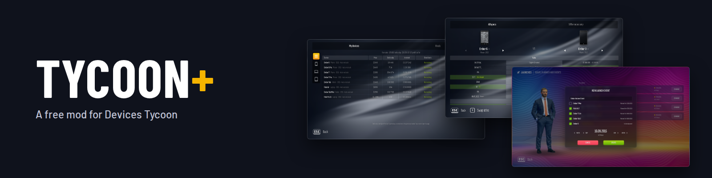
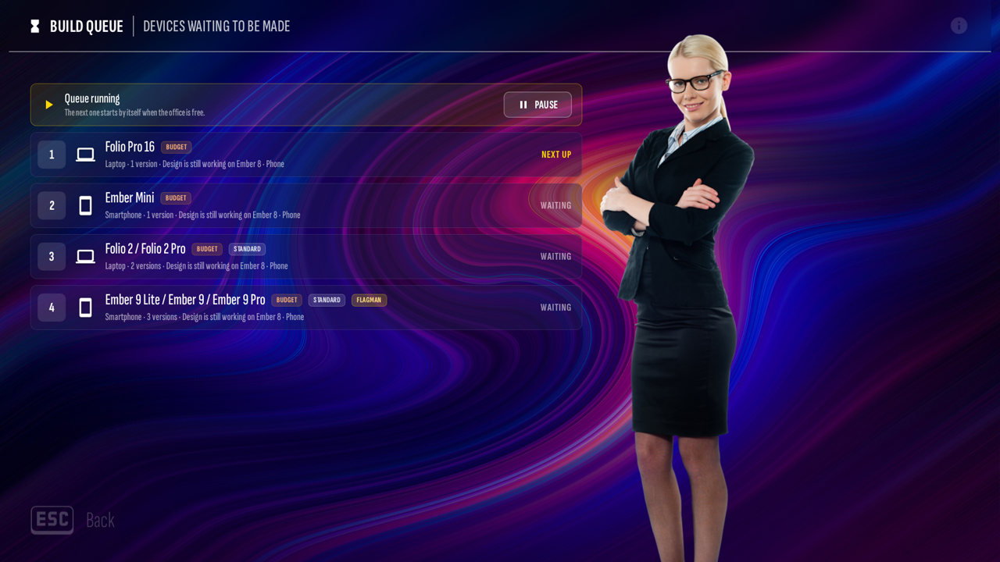
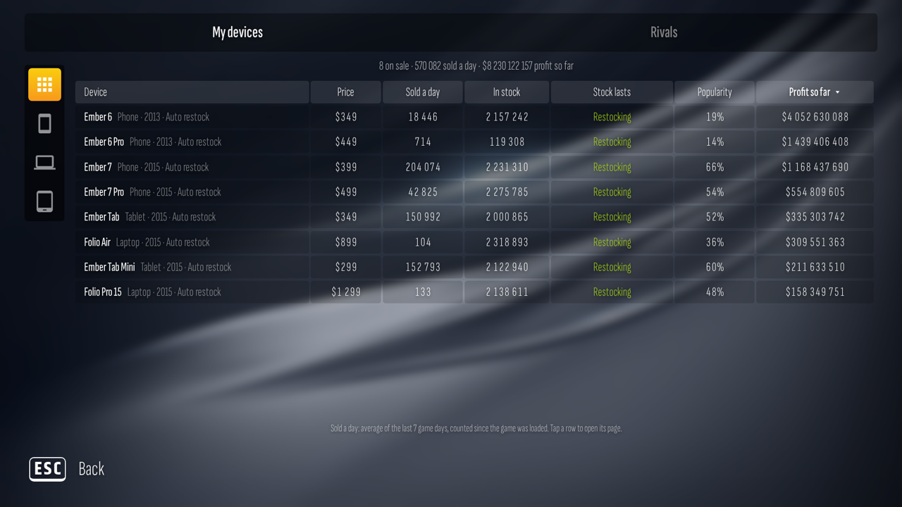
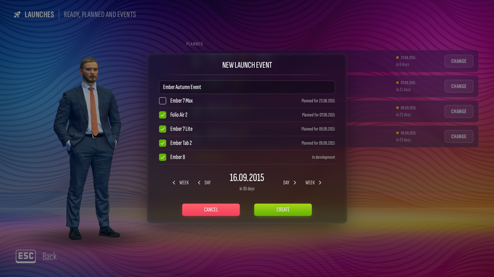
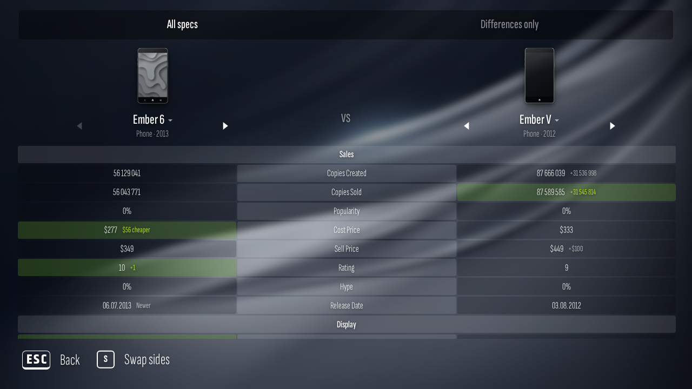

# Tycoon+ for Devices Tycoon

**An unofficial, free mod for [Devices Tycoon](https://store.steampowered.com/app/2085660/Devices_Tycoon/) that adds the stuff I kept wishing the game had.**

Queue up your next phone while the current one is still being built. Pick your own launch day. Watch rival companies launch their devices. Compare two of your designs side by side. Set the difficulty the way you like it. And a pile of smaller fixes that make a long save feel a lot smoother.



> Tycoon+ is a fan project. It isn't made, endorsed or supported by Roastery Games or Valve. If something breaks while it's installed, please [report it here](../../issues), not to Roastery.

---

## What you get

### Run your company your way
- **Build queue.** Design your next device while another one is in development. It waits in line and starts on its own.
- **Three projects at once.** Each of your three work rooms can build something at the same time, with a button to hop between them.
- **Launch day.** Once a device is reviewed, launch it today or plan a date. Several devices can go out together at one launch event, and the "hold a presentation?" offer comes on the day it goes on sale.
- **Start from a previous device.** Copy one of your old designs as the starting point for a new one.
- **Hire in bulk.** On Find Employees, run up to 20 searches at once on an agency (each extra search costs 50% more).

### Know what's going on
- **Sales board.** Every device you're selling, on one screen.
- **Compare.** Put two of your devices side by side.
- **Rivals.** Other companies launch devices on believable dates, with their own tab on the board.
- **Year in review.** A card every 1 January, and a Years tab on the stats page.
- **"Next" hints.** Under a design option that isn't out yet, see when it arrives ("Next: 90 Hz, May 2019").
- **Change price or stop selling** any device on sale.
- **Restocking** set per device: Auto, Careful or Off.

### Tune the challenge
- **Difficulty sliders** per company: how much people buy, part costs, research speed, how strong competitors are and how fast you build. There are presets too. Leave it on "Original" for the normal game.
- **Real-world parts.** Outside "Original", phone parts follow real release dates and prices, and devices get thinner as the years go on.
- **Fair reviews.** Reviewers judge the price against what the device offers for its year.

### Smoother to play
- Skip the delivery bar, review animations and presentation lines, and see a price forecast on the price page.
- No more lag when you tap quickly in the phone and tablet editor.
- The device filter on the research screen stays picked when you switch tabs.
- Bigger, easier-to-read office news cards.
- Fixed: "No" now actually closes the "hold a presentation?" offer.

Everything works in English and Russian, like the game.

|  |  |
|---|---|



---

## Install

You need Devices Tycoon from Steam on Windows. Tycoon+ doesn't include any of the game's files; it changes your own copy, on your own computer, and keeps a backup so you can go back.

**Before you start:** close the game and copy your saves somewhere safe (`Documents\Devices Tycoon`).

### The easy way

1. Download **`DevicesTycoonMods.exe`** from the [latest release](https://github.com/ellisjpeg/tycoon-plus/releases/latest).
2. Double-click it. It finds the game through Steam and asks two quick questions. Press Enter to install, and Enter again to keep the game's own company names.
3. Start the game from Steam like normal.

If it can't find the game, drag the game's folder onto `DevicesTycoonMods.exe`. It doesn't need admin rights and never connects to the internet.

**Windows says "Windows protected your PC"?** That's normal for a new program that isn't signed by a company yet. Click **More info**, then **Run anyway**. Want to check it first? See [Is it safe?](#is-it-safe)

<details>
<summary><b>Other ways to install</b> (one PowerShell command, Python, or your AI assistant)</summary>

#### One command in PowerShell

Downloads the program and its checksum from this project's releases (nowhere else), checks they match, and only then runs it. Open PowerShell from the Start menu, paste this and press Enter:

```powershell
$ProgressPreference='SilentlyContinue'; [Net.ServicePointManager]::SecurityProtocol=[Net.ServicePointManager]::SecurityProtocol -bor 3072; $u='https://github.com/ellisjpeg/tycoon-plus/releases/latest/download'; $d=Join-Path ([IO.Path]::GetTempPath()) 'TycoonPlus'; New-Item -ItemType Directory -Force $d | Out-Null; $exe=Join-Path $d 'DevicesTycoonMods.exe'; $sums=Join-Path $d 'SHA256SUMS.txt'; Invoke-WebRequest "$u/DevicesTycoonMods.exe" -OutFile $exe -UseBasicParsing; Invoke-WebRequest "$u/SHA256SUMS.txt" -OutFile $sums -UseBasicParsing; $want=((Get-Content $sums | Select-String 'DevicesTycoonMods.exe').Line -split '\s+')[0]; if ($want -and (Get-FileHash $exe -Algorithm SHA256).Hash -eq $want) { Write-Host 'Checksum OK. Starting the installer...'; & $exe } else { Write-Host 'The download does not match its checksum. Not running it.'; Remove-Item $exe }
```

#### With Python (pick your mods)

For people who'd rather run code they can read. You need [Python](https://www.python.org/downloads/) 3.10+ (tick "Add python.exe to PATH") and [Node.js](https://nodejs.org/) 18+.

1. Click **Code > Download ZIP** at the top of this page and unzip it.
2. Open the folder, click the address bar, type `cmd` and press Enter.
3. Run `python install.py status`, then `python install.py install`.

Leave parts out with `--without rivals,news`, or add real company names with `--with names`. If it can't find the game, add `--game-dir "C:\Program Files (x86)\Steam\steamapps\common\Devices Tycoon"`.

#### Ask your AI assistant

If you use an AI assistant that can run commands on your PC (or walk you through it), paste this in:

> Please help me install Tycoon+, a free, unofficial mod for the Steam game Devices Tycoon, on
> this Windows PC. Explain each step in plain words before you do it, and wait for my OK before
> anything that downloads, installs or changes a file. If you can't run commands yourself, give
> me one step at a time and wait for me to paste back what it says.
>
> Rules:
> 1. Download only from https://github.com/ellisjpeg/tycoon-plus/releases/latest, and only two files:
>    `DevicesTycoonMods.exe` and `SHA256SUMS.txt`. Nothing from anywhere else.
> 2. Before running it, check the file with PowerShell: `Get-FileHash DevicesTycoonMods.exe`. The
>    hash must match the line for DevicesTycoonMods.exe in SHA256SUMS.txt. If it doesn't, stop and
>    tell me.
> 3. Don't run anything as administrator, don't turn off antivirus or any Windows security, and
>    don't change any settings.
> 4. Remind me to close the game and offer to copy my saves folder (`Documents\Devices Tycoon`)
>    somewhere safe first.
> 5. Run `DevicesTycoonMods.exe status` and tell me what it says. If it says this game version
>    isn't supported, stop: nothing needs doing.
> 6. Run `DevicesTycoonMods.exe install`. Don't add `--with-names` unless I ask for real company
>    names.
> 7. Afterwards, tell me what changed: only the file `www\assets.dat` in the game's folder, plus
>    two backup files next to it (`assets.dat.mods.json` and `assets.dat.mods-head`).
> 8. Tell me how to undo it: `DevicesTycoonMods.exe uninstall`, or Steam's "Verify integrity of
>    game files".

</details>

### Removing it

Double-click `DevicesTycoonMods.exe` again and say yes to putting the original game back (or run `DevicesTycoonMods.exe uninstall`, or `python install.py uninstall`). Every route uses the same backup, so it doesn't matter how you installed.

No program handy? In Steam, right-click the game, then **Properties > Installed Files > Verify integrity of game files**. A Steam update to the game also removes the mods.

### Is it safe?

You don't have to take my word for it:

- **Every line is here.** The installer's source is in [`player/`](player) and each mod is in [`mods/`](mods).
- **GitHub builds the program, in public,** from this code, and keeps a signed record of it. If you use the GitHub CLI: `gh attestation verify DevicesTycoonMods.exe --repo ellisjpeg/tycoon-plus`.
- **Check you got the right file.** In PowerShell, in your downloads folder: `Get-FileHash .\DevicesTycoonMods.exe`. It should match the line in `SHA256SUMS.txt` on the release.
- **It only changes one file,** `www\assets.dat` in the game's folder, and keeps a backup of the part it changes. Nothing is sent anywhere.

---

## Questions

**Windows says "Windows protected your PC". Is this a virus?**
No. Windows shows that for any new program that isn't signed by a company yet. Click **More info**, then **Run anyway**. If you'd rather check first, see [Is it safe?](#is-it-safe), or use the Python install so you only run code you can read.

**Will it mess up my saves?**
Tycoon+ keeps its settings inside your save, next to the game's own data. Back your saves up before installing anyway. That's good practice for any mod.

**The game updated and now Tycoon+ won't install.**
That's on purpose. The installer only works on the game version it was tested with, so an update can't break your save halfway through a game. Steam updates also remove the mod. Wait for a Tycoon+ update (watch this repo or check [Releases](../../releases)).

**Do achievements still work?**
Tycoon+ doesn't touch Steam, achievements or Steam Cloud. Your saves sync as usual.

**Steam Deck or Linux?**
Not tested yet, so not officially supported. If you try it through Proton, let me know how it goes in the [issues](../../issues).

**Mac?**
Not yet. If you play on a Mac through CrossOver or similar and want Tycoon+, [open an issue](../../issues) and I'll look into it.

**Real company names?**
The game uses parody names ("Nokya") on purpose, and Tycoon+ keeps them. There's an optional `names` mod that swaps in real company names, but it's off unless you turn it on.

**Can I pick which parts I want?**
Yes, with the Python install (`--without rivals,names` and so on). The full list of parts is in [docs/MODS.md](docs/MODS.md).

**Something's broken.**
[Open an issue](../../issues/new/choose) and tell me what you did, what happened, and your game version. Please don't send Tycoon+ bugs to Roastery.

---

## How this was made

I'm a solo developer with very little spare time. Tycoon+ started as a personal project: a list of things I wanted while playing. It grew big enough that I thought other people might enjoy it too.

To be upfront: **most of the code was written with AI tools (Claude), directed by me.** Every idea, every screen and how it should look and feel came from me. I played it, sent things back when they felt wrong, and kept going until it played the way I wanted. On my own, without AI, this would have taken years, or never happened at all.

It's free, and it'll stay free. If you enjoy it, a star on this repo genuinely helps.

Thanks to Roastery Games for making a game I wanted to spend this much time in.

---

## How it works

Devices Tycoon is built with Construct 3, and the Windows version keeps its code in one file, `www/assets.dat`. The installer reads that file from your install, adds Tycoon+'s code to the end, points the game at it, and saves a backup of the small part it changes. Removing it puts that part back and checks the file matches the original byte for byte. Nothing is downloaded and none of the game leaves your computer.

Each mod lives in its own folder in [`mods/`](mods). It looks for exact spots in the game's code and adds a small hook there. If the game has changed and a spot is missing, the whole install stops instead of guessing.

Building it yourself, running the tests and adding a mod: see [CONTRIBUTING.md](CONTRIBUTING.md).

## Licence

Tycoon+'s own code is [MIT licensed](LICENSE). That covers only this project's files, not the game. Devices Tycoon, its code, art, sound and text belong to Roastery Games. See [NOTICE](NOTICE).
